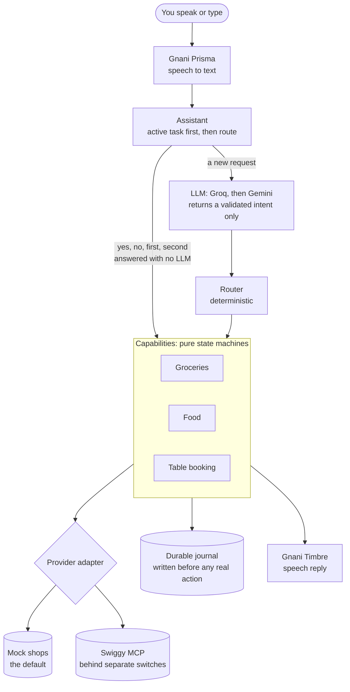

# Namma Saathi

**Your personal AI for everyday life.** Say what you need in Kannada, Hindi, or English, and Saathi
helps get it done.

One conversation, three everyday tasks:

| Task | You say | Service |
|---|---|---|
| Groceries | "I need rice and milk" | Swiggy Instamart |
| A meal | "I want something for dinner" | Swiggy Food |
| A table | "A table for two in Indiranagar tomorrow at 7 PM, Italian" | Swiggy Dineout |

Switch tasks whenever you like. Ask for a table halfway through your groceries, and the basket waits
for you. A yes only ever applies to what Saathi just read back.

> **Project status:** all three journeys work end to end on built-in mock shops, with real speech and
> a real LLM. **No real order or booking has been placed.** Live Swiggy access is limited to what is
> listed under [Status](#status), and production access has been requested but not granted.

## Why it is built this way

Most assistants that can spend money trust a language model to decide when to do it. Saathi doesn't.

**The LLM only understands language.** It has no tools and no credentials, and it can't touch a cart.
Ordinary, tested code owns every decision: what goes in the cart, what counts as approval, and
whether an order really happened.



## How real actions stay safe

- **Nothing is chosen silently.** A product is picked without asking only if exactly one in-stock
  option makes exactly what you asked for. Otherwise Saathi reads out up to three.
- **Approval is bound to what you heard.** A yes covers one exact readback of items, prices, fees,
  total, address, and payment. Any change needs a new readback, and the LLM's opinion never counts.
- **Your existing carts are protected.** They are read first and kept. A Food cart never silently
  switches restaurant.
- **Nothing runs twice by accident.** Every attempt is saved before the call, and checkout is never
  retried blindly. An unclear result is checked against order history, and anything unproven blocks
  all real actions until a person settles it.
- **Results are worded truthfully.** A demo is never called real, a real order is never called a
  demo, and an unverified order is never called verified.
- **Real actions are off by default.** Each has its own switch, and the public deployment refuses to
  start with any of them on.

## Quick start

You need Python 3.12 and [uv](https://docs.astral.sh/uv/).

```bash
cp .env.example .env     # add GNANI_API_KEY, plus GROQ_API_KEY or GEMINI_API_KEY
uv sync
uv run uvicorn app.web:app
```

Open <http://localhost:8000>, choose a language, and speak or type. Everything runs on mock shops
and nothing reaches Swiggy. [docs/demo-script.md](docs/demo-script.md) has a full script to follow.

With no LLM key, set `DEMO_UNDERSTANDING=scripted` to use simple rules instead. It works only in mock
mode, and the page tells you whenever it was used.

## Status

Checked on 5 November 2026. [docs/integration-status.md](docs/integration-status.md) has every step.

| | Mock journey | Live reads | Live cart change | Live order or booking |
|---|---|---|---|---|
| Instamart | Works | Verified | Worked once in a rehearsal | Never run |
| Swiggy Food | Works | Search and order history verified | Never run | Never run |
| Swiggy Dineout | Works | Search and slots verified | Not applicable | Never run |

Swiggy has not confirmed that a personal app may place real orders, so execution stays off until it
does. See [docs/first-real-order.md](docs/first-real-order.md) for the gated procedure.

### Speed

Measured with real Gnani and LLM services on mock shops, 5 November 2026:

| Stage | Typical time |
|---|---|
| Speech recognition | 0.3 to 0.6 s |
| Understanding (Groq) | 1 to 2 s, or 5 to 13 s when Gemini takes over |
| Mock provider and orchestration | under 0.03 s |
| Speech reply | 0.6 to 2.3 s |
| **A whole new request** | **2 to 4 s** |
| **A yes, which skips the LLM** | **about 1 s** |

Add `?timings=1` to the page address to see these for each turn.

## Tech stack

| Layer | Choice |
|---|---|
| App | Python 3.12, FastAPI, a plain HTML and JavaScript push-to-talk page |
| Speech | Gnani Prisma (recognition) and Timbre (voice) |
| Understanding | Groq, then Gemini, with a strict Pydantic schema |
| Swiggy | Official MCP SDK over Streamable HTTP; OAuth 2.1 with PKCE and Dynamic Client Registration |
| Deployment | Docker on Render's free plan, mock shops only; see [docs/deployment.md](docs/deployment.md) |
| Quality | pytest (704 tests), Node tests for the page (17), ruff, pyright, GitHub Actions |

## Repository layout

```text
app/assistant/      one assistant over all capabilities: routing, task switching
app/orchestrator/   the order engine for groceries and food: state machine, checkout
app/dining/         table booking: its own state machine and workflow
app/commerce/       Instamart adapter, the MCP client, mock shop, order journal
app/food/           Swiggy Food adapter and mock
app/llm/            intent schema, provider chain, scripted fallback
app/voice/          Gnani speech, and every phrase Saathi says in three languages
app/static/         the browser page
scripts/            record a demo, verify a deployment
docs/               status, deployment, demo script, Swiggy notes
```

## Commands

```bash
uv run python -m app.demo_check --voice  # rehearse every journey with real speech, on mock shops
uv run --with playwright python scripts/record_demo.py demo.mp4  # record a demo video
uv run python scripts/verify_deployment.py https://…  # check a deployment, print its redirect URI
uv run python -m app.swiggy_auth         # sign in to Swiggy; the token stays in the OS keyring
uv run python -m app.swiggy_preflight    # read-only readiness report for Instamart
uv run python -m app.order_admin status  # every attempt in the journal, and how to settle one
```

### Checks

```bash
uv run ruff check . && uv run ruff format --check . && uv run pyright && uv run pytest
node --test tests/frontend/namma-saathi.test.cjs
```

## Configuration

Everything real is off unless switched on. [.env.example](.env.example) lists every setting.

| Setting | Default | Effect |
|---|---|---|
| `COMMERCE_BACKEND` | `mock` | `mock` never constructs a Swiggy client |
| `SWIGGY_LIVE_ACCESS` | `false` | Read your real account |
| `ALLOW_SWIGGY_CART_WRITES` | `false` | Change your real Instamart and Food carts |
| `ALLOW_REAL_CHECKOUT` | `false` | Place real orders; needs the above and `MAX_REAL_ORDER_INR` |
| `ALLOW_REAL_BOOKING` | `false` | Book real free tables |
| `MAX_REAL_ORDER_INR` | none | Refuse any order above this total |
| `REAL_ORDER_LIMIT` | `1` | Real orders and bookings allowed before refusing more |
| `LLM_PRIMARY` | `groq` | Which LLM goes first: `groq` or `gemini` |
| `DEMO_UNDERSTANDING` | `llm` | `fallback` or `scripted` add simple rules, in mock mode only |
| `PUBLIC_DEPLOYMENT` | `false` | Public mode: mock shops only, with a daily usage cap |

## Known limitations

- **Food:** optional add-ons are not offered, and dishes that require add-ons or several separate
  choices are left out. There is no "your usual". One restaurant per cart.
- **Dineout:** free reservations only, since paid deals need UPI. Search works only for places with
  documented coordinates: Bengaluru, Koramangala, Indiranagar, Mumbai, and Delhi. Its live
  responses are text, so a format change would stop bookings rather than risk a wrong one. There is
  no booking history to check, so a lost reply stays unknown until a person checks the app.
- **Payment:** cash on delivery only.
- **Voice:** tested with synthesized speech, not yet with people at a microphone. Kannada and Hindi
  phrases need review by native speakers. Hinglish goes through `hi-IN`.
- **Sessions:** in memory, so a restart loses the conversation but not the journal. A real account
  means one user, one process, on this machine.
- **Speed:** measured with real services on 5 November 2026, a spoken turn took 1 to 4 seconds when
  Groq answered and 0.9 to 1.1 seconds for a yes, which skips the LLM. Groq's free tier rate-limits
  quickly, and Gemini then takes 5 to 13 seconds. An unclear real checkout adds about 30 seconds.
- **Hosted demo:** mock shops only. The hosted Swiggy sign-in stops at the callback and has only run
  against a stand-in server; live ordering per hosted user is not built.

## Learn more

- [DESIGN.md](DESIGN.md): product scope, safety invariants, and architecture (see §16)
- [docs/integration-status.md](docs/integration-status.md): what is mocked, read-only, or blocked
- [docs/swiggy-integration-notes.md](docs/swiggy-integration-notes.md): verified Swiggy behaviour
- [docs/demo-script.md](docs/demo-script.md): the demo, with recovery steps and checklists
- [docs/deployment.md](docs/deployment.md): the public demo and the sign-in callback

Namma Saathi grew out of Ajji Mart, a voice grocery assistant, and is an entry in the Gnani AI Great
Indian AI Internship Challenge.
